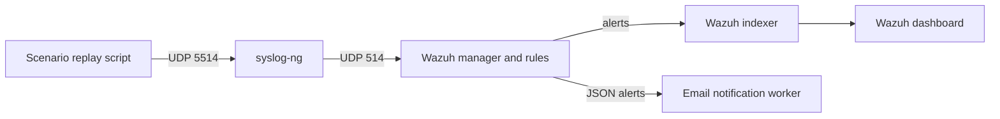

# Lab 5 — Network Anomaly Detection and Log Management

This lab uses syslog-ng to collect five safe, synthetic security events and forward them to Wazuh. Wazuh applies local detection rules, stores alerts in its indexer, and presents them in the Wazuh dashboard. The scenarios demonstrate detection logic; they do not exploit a real host or generate network scans.

## Architecture



Wazuh bundles the manager, indexer, and dashboard integration. Its indexer is OpenSearch based, rather than standalone Elasticsearch/Kibana; the dashboard provides the search and visualization interface for Wazuh alerts. This stack choice follows the assignment's Wazuh recommendation.

## Five detection scenarios

| Rule | Scenario | Signal and interpretation |
|---|---|---|
| 100501 | SSH password guessing | Several authentication failures from one source; possible credential attack |
| 100502 | Port sweep | One source probes multiple destination ports; possible reconnaissance |
| 100503 | Web path traversal | Request includes `../`; possible attempt to read files outside the web root |
| 100504 | SQL injection probe | Request contains a SQL tautology marker; possible injection attempt |
| 100505 | DNS tunneling indicator | Unusually long encoded-looking DNS label; possible covert channel |

Each replayed message is explicitly labelled `LAB5` and contains synthetic evidence. These simple rules are teaching examples and need tuning before use on real networks.

## Requirements

- Linux VM or Docker host with Docker Compose, at least 4 CPU cores, 8 GB RAM, and 50 GB free disk for the Wazuh single-node stack.
- Set `vm.max_map_count` to `262144` on Linux hosts before starting the indexer.
- Internet access for the first run to retrieve the pinned Wazuh stack and container images.

## Deploy

From the project directory:

```sh
./scripts/setup.sh
```

The setup script obtains the official Wazuh Docker single-node deployment at version 4.14.10, generates its self-signed certificates, adds the lab's remote-syslog listener and custom rules, and starts the stack. The syslog-ng relay listens on UDP 5514. The dashboard is at `https://localhost` (first sign-in: `admin` / `SecretPassword`). Change the default credentials for any network-accessible deployment.

Allow a few minutes for startup. Check status with:

```sh
docker compose -p lab5 -f vendor/wazuh-docker/single-node/docker-compose.yml -f docker-compose.lab5.yml ps
```

## Replay and inspect

```sh
python3 scripts/replay_scenarios.py
```

In the Wazuh dashboard, open **Threat Hunting → Events** and enter this query:

```text
rule.id: 100501 or rule.id: 100502 or rule.id: 100503 or rule.id: 100504 or rule.id: 100505
```

Choose **Last 15 minutes** after replay and click **Update**. The lab query should return one event for each rule. Display `timestamp`, `agent.name`, `rule.description`, `rule.level`, and `rule.id`; open an event to inspect its full log, including source and destination. In this configuration the IP values are preserved in `full_log` rather than confirmed as separate parsed fields. `sample-logs/scenarios.jsonl` lists the exact events replayed.

For a saved visualization, use the OpenSearch Dashboards visualization workflow to chart alert count over time and break down the series by `rule.id`; save it as **Lab 5 Alerts by Rule** and add it to a dashboard named **Lab 5 Network Anomalies**. The included run used the standard Wazuh Threat Hunting dashboard and did not save this separate custom dashboard.

Check manager alert output with:

```sh
docker exec wazuh.manager sh -c 'tail -n 30 /var/ossec/logs/alerts/alerts.json'
```

## Email alerts

The alert notifier watches the manager's JSON alert log and sends Lab 5 alerts to the local Mailpit inbox at `http://localhost:8025`. This demonstrates email delivery without sending messages outside the lab. Optional external SMTP setup is in `docs/NOTIFICATIONS.md`; do not put credentials in source control.

## Stop and clean up

```sh
docker compose -p lab5 -f vendor/wazuh-docker/single-node/docker-compose.yml -f docker-compose.lab5.yml down
```

The command preserves indexed data. Add `-v` only when you intentionally want to delete all lab data.

## Repository map

- `config/syslog-ng/syslog-ng.conf` — UDP collection and forwarding
- `config/wazuh/rules/local_rules.xml` — five lab detection rules
- `sample-logs/scenarios.jsonl` — synthetic event fixtures
- `scripts/` — setup and replay helpers
- `docs/` — scenario analysis and notification setup

## Limitations and next steps

These signatures detect known strings in intentionally labelled sample logs; they do not establish that an intrusion succeeded. A production design should use endpoint and network telemetry, richer parsing, time-window correlation, thresholding, authenticated/encrypted log transport, access controls, retention policies, and alert triage. Further work could map detections to MITRE ATT&CK, add Suricata events, and test precision/false-positive rates against a benign baseline.
