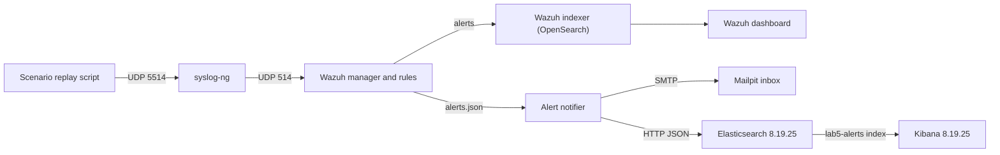

# Lab 5 — Network Anomaly Detection and Log Management

This project demonstrates collection, detection, visualization, and notification for five safe, synthetic security events. `syslog-ng` forwards events to Wazuh, custom Wazuh rules create alerts, and a notifier copies matching alerts to standalone Elasticsearch and the local Mailpit inbox. Kibana visualizes the Elasticsearch copy. The replay uses documentation IP addresses and reserved test domains; it does not attack a real host or perform a live port scan.

## Architecture



Wazuh's native indexer is OpenSearch-based. The additional Elastic containers provide standalone Elasticsearch and Kibana. Elasticsearch stores a copy of each matching custom-rule alert in `lab5-alerts`; Wazuh retains its own alert records and dashboard. Host ports 9201 and 5601 are bound to loopback only.

## Detection scenarios

| Rule ID | Scenario | Detection signal and interpretation |
|---|---|---|
| 100501 | SSH password guessing | A message summarizing repeated authentication failures; possible credential guessing. |
| 100502 | Port sweep / service reconnaissance | One source probes multiple destination ports; possible service discovery. |
| 100503 | Web path traversal | An HTTP request contains encoded parent-directory markers; possible attempt to escape the web root. |
| 100504 | SQL injection probe | A request contains an encoded quote and tautology marker; possible attempt to alter query logic. |
| 100505 | DNS tunneling indicator | A long encoded-looking DNS label and TXT query; possible covert-channel activity. |

These are single-event teaching signatures. They indicate suspicious patterns, not proof that an intrusion succeeded, and should be tuned before use on real traffic.

## Requirements

- Docker Desktop or Docker Engine with the Docker Compose plugin, plus Git and Python 3.
- For the Wazuh single-node stack: at least 4 CPU cores, 8 GB RAM, and 50 GB free disk.
- Allow roughly 3.5 GB additional Docker memory for standalone Elasticsearch and Kibana.
- On Linux, set `vm.max_map_count` to `262144` before starting the Wazuh indexer.
- Internet access is needed on first setup to retrieve the pinned Wazuh deployment and container images.

## Start the lab

Run from the project root:

```sh
./scripts/setup.sh
```

The setup script retrieves the official Wazuh Docker deployment pinned to v4.14.10 (if it is not already present), prepares the local syslog and rule configuration, generates Wazuh certificates, and starts the Wazuh, syslog-ng, notifier, Mailpit, Elasticsearch, and Kibana services.

After the services start, create the Elasticsearch index template and Kibana data view once:

```sh
python3 scripts/setup_kibana.py
```

The setup creates the **Lab 5 Security Alerts** data view over `lab5-alerts*`, with `timestamp` as its time field. Wait a few minutes for the first startup before opening the dashboards:

- Wazuh: <https://localhost>
- Kibana: <http://localhost:5601>
- Mailpit inbox: <http://localhost:8025>
- Elasticsearch API: <http://localhost:9201>

The local Wazuh certificate may produce a browser warning because it is self-signed. The standalone Elastic services have authentication and TLS disabled for this isolated classroom lab; their host ports are bound to `127.0.0.1`. Keep those bindings and do not expose the services to an untrusted network. The Wazuh default credentials are `admin` / `SecretPassword`; change them before any network-accessible use.

Check all services, including standalone Elastic, with the same Compose file list used to start them:

```sh
docker compose -p lab5 \
  -f vendor/wazuh-docker/single-node/docker-compose.yml \
  -f docker-compose.lab5.yml \
  -f docker-compose.kibana.yml ps
```

## Replay the five scenarios

```sh
python3 scripts/replay_scenarios.py
```

The script sends one synthetic event per scenario through UDP 5514. In Wazuh, open **Threat Hunting → Events**, search for the five rule IDs, choose **Last 15 minutes**, then update the results:

```text
rule.id: 100501 or rule.id: 100502 or rule.id: 100503 or rule.id: 100504 or rule.id: 100505
```

Display `timestamp`, `agent.name`, `rule.description`, `rule.level`, and `rule.id`. Open an event to inspect the complete log. Source and destination IP values are present in `full_log`; this lab does not claim they are separately parsed fields. The exact replay fixtures are in `sample-logs/scenarios.jsonl`.

The manager's alert file can also be inspected from the project root:

```sh
docker compose -p lab5 \
  -f vendor/wazuh-docker/single-node/docker-compose.yml \
  -f docker-compose.lab5.yml \
  -f docker-compose.kibana.yml \
  exec wazuh.manager sh -c 'tail -n 30 /var/ossec/logs/alerts/alerts.json'
```

## Custom Kibana dashboard

Open **Dashboards → Lab 5 Security Anomaly Dashboard** at <http://localhost:5601>. The saved dashboard is separate from Wazuh's built-in overview and filters on all five custom rule IDs:

```text
rule.id: (100501 OR 100502 OR 100503 OR 100504 OR 100505)
```

It contains two visualizations over the `lab5-alerts` index:

- **Lab 5 alerts by rule ID** — count of alert documents for each scenario.
- **Lab 5 alerts by severity** — alert counts grouped by Wazuh rule level.

After replay, set the time picker to **Last 15 minutes**. One event per rule is expected for one replay batch; the five-event example has two level-8 and three level-10 alerts. To replay and check the Elasticsearch document count:

```sh
python3 scripts/replay_scenarios.py
curl -s http://127.0.0.1:9201/lab5-alerts/_count
```

The report includes Wazuh, Mailpit, and Docker screenshots. Its Kibana chart figure is a report visualization of values verified against Elasticsearch; it is explicitly not a screenshot of the Kibana browser interface.

## Email notifications

The notifier follows the Wazuh JSON alert file and sends one local email for each newly observed matching rule. Messages contain the alert timestamp, rule ID, description, severity level, and raw event context. View them in Mailpit at <http://localhost:8025>. Mailpit captures mail locally; no external recipient is contacted. Optional SMTP configuration is described in [`docs/NOTIFICATIONS.md`](docs/NOTIFICATIONS.md). Do not commit SMTP credentials.

## Stop the lab

```sh
docker compose -p lab5 \
  -f vendor/wazuh-docker/single-node/docker-compose.yml \
  -f docker-compose.lab5.yml \
  -f docker-compose.kibana.yml down
```

This stops and removes the containers while preserving named volumes and indexed data. Add `-v` only if you intentionally want to delete the lab's stored data.

## Project files

- `config/syslog-ng/syslog-ng.conf` — UDP event collection and forwarding.
- `config/wazuh/decoders/local_decoder.xml` — custom event decoder.
- `config/wazuh/rules/local_rules.xml` — five custom detection rules.
- `sample-logs/scenarios.jsonl` — synthetic event fixtures.
- `scripts/` — setup, Kibana initialization, notification, and replay scripts.
- `docker-compose.lab5.yml` and `docker-compose.kibana.yml` — lab service configuration.
- `docs/` — scenario analysis and notification setup.
- `Lab5_Report.docx` — detailed lab report and evidence.

## Limitations and production considerations

The rules are simple signatures for labelled sample events; they do not aggregate attempts over time or establish successful compromise. Real deployment needs endpoint and network telemetry, validated parsing, time-window correlation, benign baselines, tuned thresholds, authenticated and encrypted log transport, access controls, retention policies, and alert triage. Additions such as Suricata or firewall telemetry would provide richer network context.
